# MyPiano

A free, browser-based piano game for kids. Notes scroll across a grand staff, the kid plays them, and a cartoon coach cheers them on. It listens to a **real piano through the microphone**, and it also works with a **USB-MIDI keyboard** or the **on-screen keys**. Nothing to install: open it at **[mypiano.srichakram.in](https://mypiano.srichakram.in)**.

## Screenshots


<details>
<summary><b>Browse all screenshots</b></summary>
<br>

| | | |
|---|---|---|
| 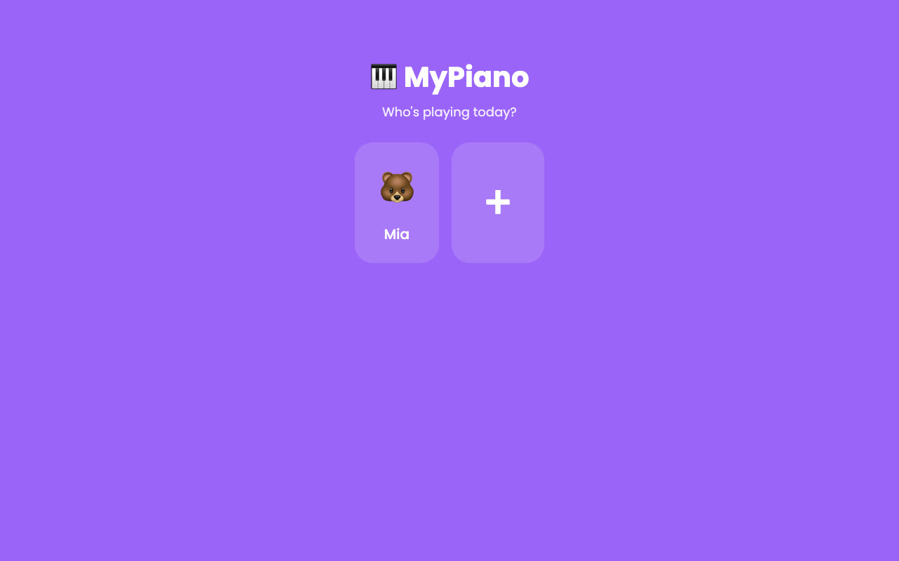<br>Who's playing? | 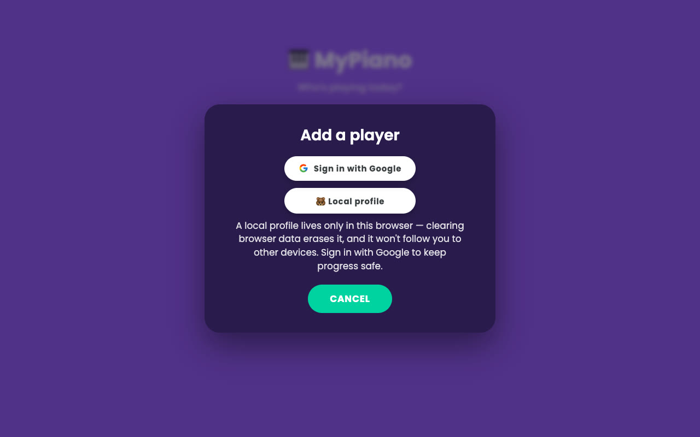<br>Add a player | 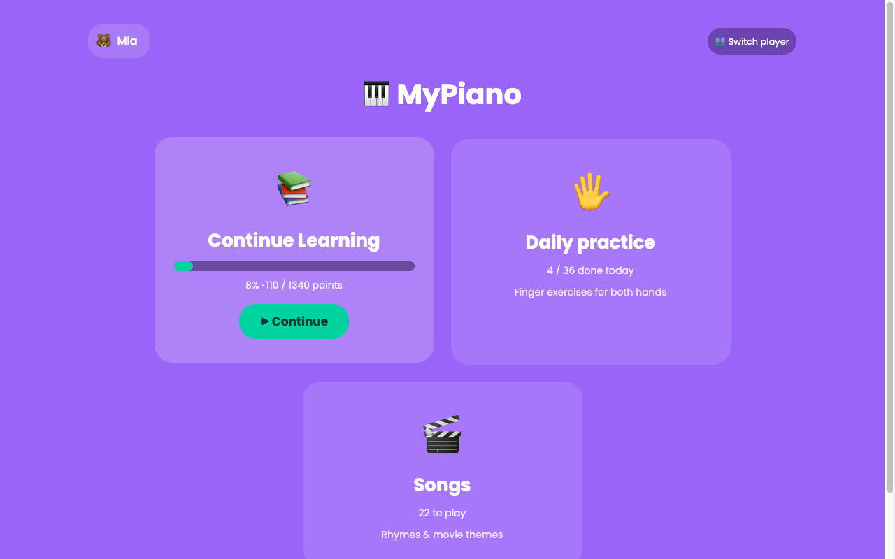<br>Home |
| 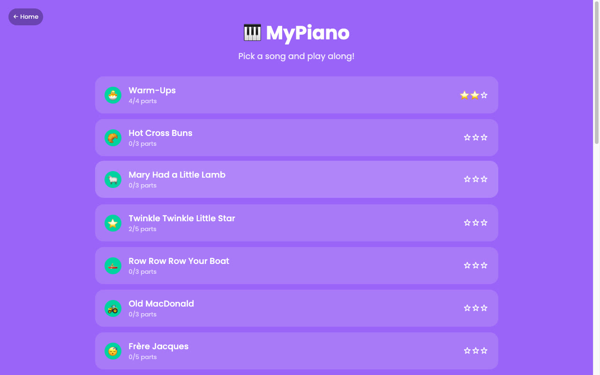<br>Lessons | 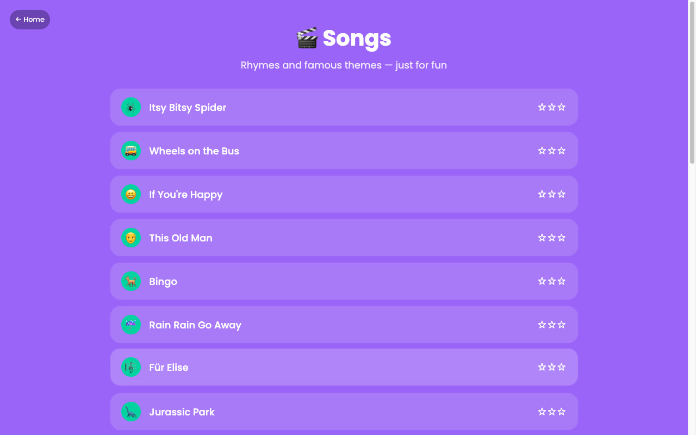<br>Songs | 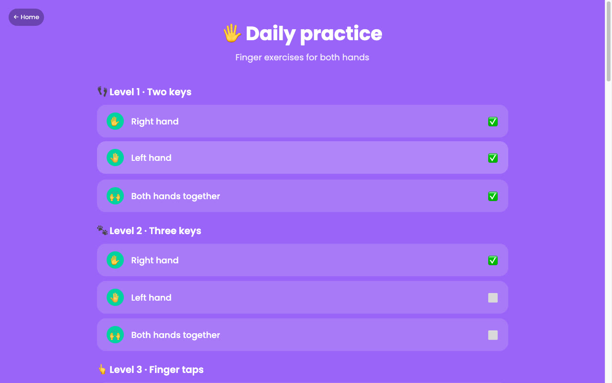<br>Daily practice |
| 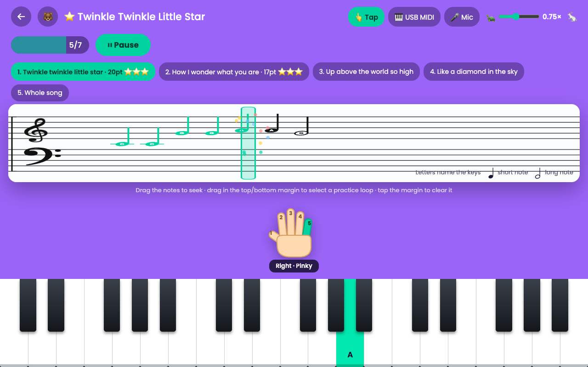<br>Playing a lesson | 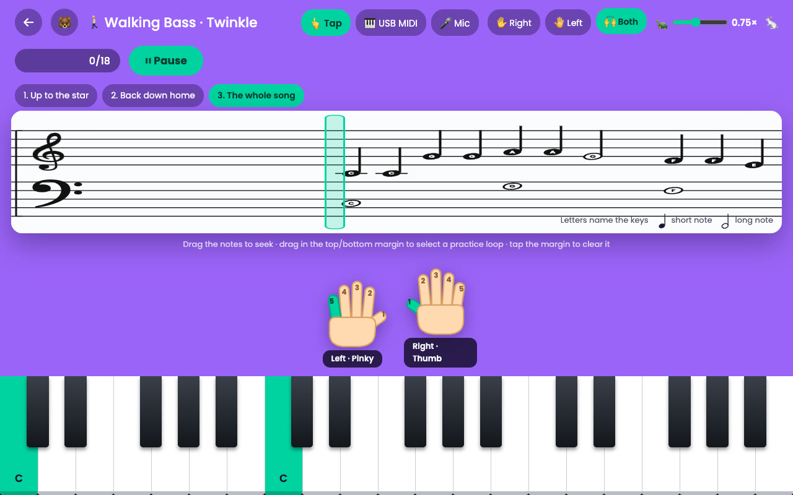<br>Two hands | 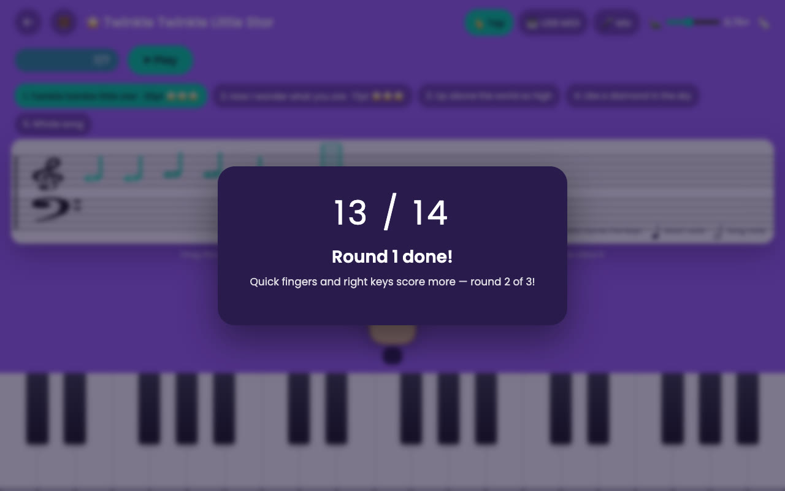<br>Round score |
| 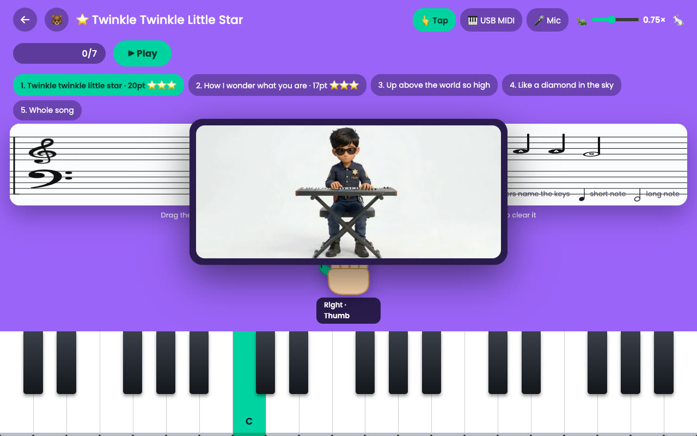<br>Coach video | 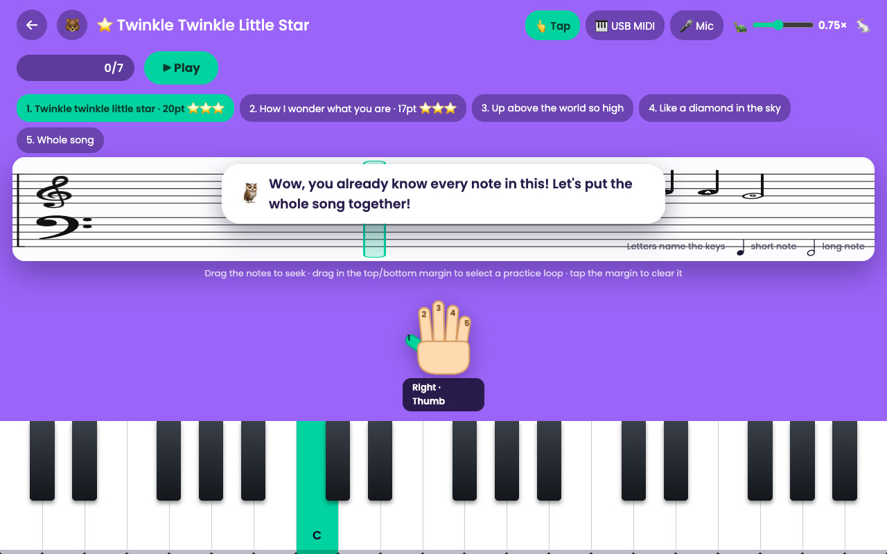<br>Tutor | 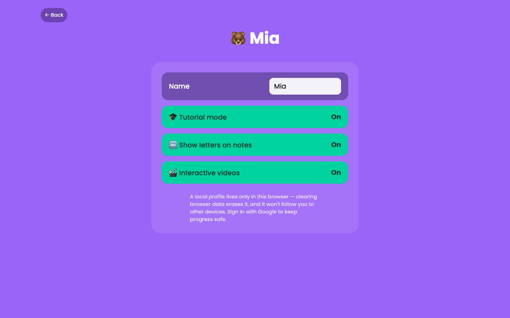<br>Profile settings |

</details>

## Features

- **Inputs** (switch any time during a lesson):
  - 🎤 **Mic**: listens to a real piano and detects the pitch of each note. The app stays silent so it doesn't hear itself.
  - 🎹 **USB MIDI**: exact input from a MIDI keyboard, played back with a sampled grand piano.
  - 👆 **Tap**: on-screen keys, or the computer keys `A S D F G H`.
- **Lessons:** a guided path from Middle C to two-hand pieces. Each song is split into short parts, then played whole. Each part earns up to three stars.
- **Songs:** nursery rhymes and famous themes, played just for fun.
- **Daily practice:** 12 levels of finger exercises for the right hand, the left hand and both together. The checklist resets every day.
- **Teaching aids:**
  - a coach character with short video clips
  - a tutor that demos each new note before the kid plays it
  - a finger guide that shows which hand and finger to use
  - letters on the notes, which you can turn off
- **Practice controls:** a speed slider (0.25×–1.5×), drag-to-seek on the staff, and practice loops.
- **Forgiving scoring:** a wide timing window. Hits are celebrated and misses aren't punished.
- **Bring your own song:** import any `.mid` file. The highest-pitched track becomes the melody, and the other tracks play as backing.
- **Players:**
  - several local profiles, each with its own progress and settings
  - optional Google sign-in that syncs a profile to the account's private Drive app-data folder

## Getting started

**Play online:** [mypiano.srichakram.in](https://mypiano.srichakram.in). Use Chrome or Edge for USB-MIDI keyboards. Mic mode works in any modern browser, after you allow microphone access.

**Run locally** (requires Node 20+)
```bash
npm install
npm run dev        # http://localhost:5173
```

Other scripts: `npm run build`, `npm run preview`, `npm run check` (type-check) and `npm test`.

To turn on Google sign-in, add `VITE_GOOGLE_CLIENT_ID=…` to `.env.local`. Without it the app works fully with local profiles. See [DEPLOY.md](DEPLOY.md) for the OAuth setup and how pushes to `main` publish the site.

## License

The code is under the [MIT License](LICENSE).

---

<sub>Mic detection hears one note at a time. To play chords, use USB MIDI or the on-screen keys.</sub>
